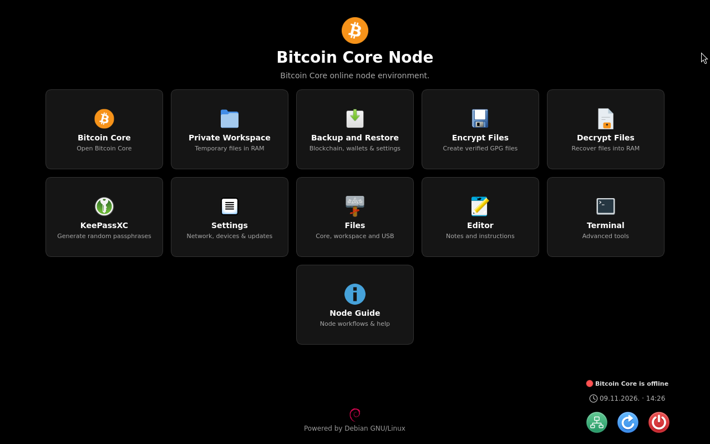
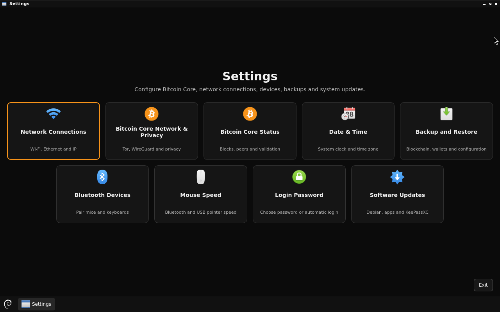

# Bitcoin Core Node — Debian image releases

**Bitcoin Core Node v0.1.0-rc.4** · [Download the approved ISO and matching source](https://github.com/btcpavao/bitcoin-core-node-releases/releases/tag/v0.1.0-rc.4) · [Release notes and evidence](docs/RELEASE-v0.1.0-rc.4.md)

**PGP signature pending.** The exact owner-approved ISO is published with its checksum, matching source and build provenance. The publisher's signature has not yet been uploaded; the checksum alone does not authenticate the publisher. Signed RC3 remains available as a historical release.

An independently developed online Bitcoin Core Node environment for amd64 Intel/AMD computers, based on Debian GNU/Linux 13 and the official Bitcoin Core 32.1 binaries. Designed to pair with a separate offline signer such as [Bitcoin Core Vault](https://github.com/btcpavao/bitcoin-core-vault-releases).

## Current download

- ISO: `bitcoin-core-node-v0.1.0-rc.4-core32.1-amd64.iso`
- Size: 1,800,142,848 bytes (1.80 GB).
- SHA-256: `b25093180bb9b8f57adf2163634be3473fbc0f5163e9fcb05008651f2e0f6da7`.
- Publisher fingerprint: `787A 2AAF B0D1 19CA 0522 B2A5 B9C9 9AF8 5788 96D0`.

The release fixes installation-disk selection, uses network-neutral Wi-Fi password guidance, keeps Backup and Restore in Settings, and uses Private Workspace as the single temporary RAM workspace. The extra Home storage/pruning sentence is removed, and the storage popup now matches the padded Date & Time popup.

The project owner approved the exact image on 26 November 2026. It was not rebuilt for publication. The final UI overlay received targeted source, Qt preview and image-content checks. Its preceding base received separate installer checks. [The release evidence](docs/RELEASE-v0.1.0-rc.4.md#source-and-evidence) keeps these scopes and source/build identities distinct.

## Check the download

Download the ISO and `SHA256SUMS` from the [same release](https://github.com/btcpavao/bitcoin-core-node-releases/releases/tag/v0.1.0-rc.4), then run `sha256sum --check --ignore-missing SHA256SUMS` in their directory. This checks integrity only while the PGP signature is pending. The release notes describe signature verification once the owner's signature is available.

The source archive, `SOURCE-COMMIT.txt`, `SOURCE-PROVENANCE.json`, recipe archive and matching Calamares corresponding source are attached to the release. The recipe preserves the actual derivation scripts and inputs; it does not establish a self-contained public fresh rebuild of rc.4.

## Historical RC3 reproducibility

[RC3](https://github.com/btcpavao/bitcoin-core-node-releases/releases/tag/v0.1.0-rc.3) has signed checksums and two byte-identical GitHub rebuilds of its own ISO. Its SHA-256 is `39e9b5b76dce7d9854989365d389caa50d55f0b0c5654602eafc7e12904b6675`. [Build record](docs/proofs/v0.1.0-rc.3.json) · [Comparison run](https://github.com/btcpavao/bitcoin-core-node-releases/actions/runs/44714236174) · [Historical RC3 rebuild guide](docs/REBUILD.md).

Those results apply to RC3, not the new RC4 artifact. The existing `rebuild/node` workflow remains the historical RC3 workflow.

## Screenshots

Actual Bitcoin Core Node v0.1.0-rc.1 interface, captured at 1280 × 800 in a demonstration session. No personal wallets, credentials or funds are shown. Open an image to see it at full size.

The Node capture is intentionally disconnected from the network. The optional Home backup shortcut is enabled.

### Node Home

The installed Node home. The optional Backup and Restore shortcut is enabled after customization.

### Node Settings

Network, devices, backups, optional login password and software updates.

### Node Guide

Built-in guidance for validation, watch-only wallets and PSBT workflows.

[Capture details](docs/screenshots/CAPTURE.json) · [Website gallery](https://btcpavao.com/en/bitcoin-core/debian-images/#online-node)

## What it does

The installed Node maintains a persistent blockchain, wallet data and configuration. Home includes Bitcoin Core, Wallets, Private Workspace, encryption/decryption tools, KeePassXC, Files, Editor and Node Guide. Backup and Restore is available in Settings. Use the RAM-only Private Workspace for temporary sensitive files and PSBT transfer; a separate PSBT Transfer Folder is no longer created.

The built-in Guide explains receiving with a Vault-exported watch-only wallet, offline PSBT signing, pruning, device privacy and recovery. Backup categories include blockchain/chainstate, wallet backups, portable Core configuration and supported Node settings. Keep signing keys on the separate offline signer.

Backup exports complete after copying and flushing without a second read-back pass; restore-time validation remains enabled. An optional desktop login password does not encrypt the disk. Installation writes to the selected target drive. Private Workspace is temporary; ordinary Node blockchain and configuration data persist.

## Scope and source

The current release is an owner-approved test candidate. No fresh full-suite or VM-installation pass was performed for its final six-file UI overlay. Full mainnet sync, every hardware/adapter configuration, Secure Boot and independent security audit are not established by the scoped evidence. Apple Silicon/M-series Macs are not supported.

See [the release's exact evidence](docs/RELEASE-v0.1.0-rc.4.md), its attached source/provenance and [third-party notices](THIRD_PARTY_NOTICES.md). Project-local code does not yet have a specified blanket license; upstream packages retain their licenses.

Website download guide: https://btcpavao.com/en/bitcoin-core/debian-images/
