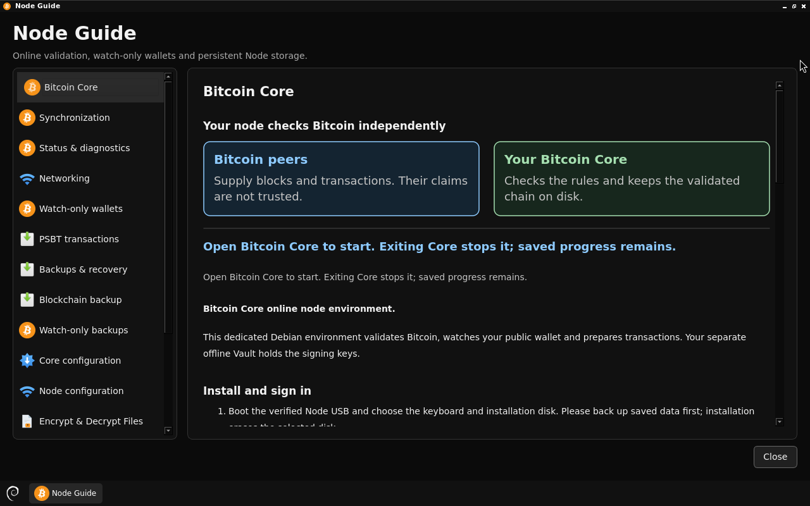

# Bitcoin Core Node — Debian image releases

**Bitcoin Core Node v0.1.0-rc.3** · [Download the ISO, signed checksums and matching source](https://github.com/btcpavao/bitcoin-core-node-releases/releases/tag/v0.1.0-rc.3) · [Rebuild the ISO](docs/REBUILD.md) · [Build jobs and comparison](https://github.com/btcpavao/bitcoin-core-node-releases/actions/runs/44714236174).

An independently developed online Bitcoin Core Node environment for ordinary amd64 Intel/AMD computers, based on Debian GNU/Linux 13 and the official Bitcoin Core 32.1 binaries. Designed to pair with a separate offline signer such as [Bitcoin Core Vault](https://github.com/btcpavao/bitcoin-core-vault-releases).

Pavao tested this ISO on a ThinkPad T550. The signed checksum list identifies the published ISO, the matching project source and the pinned recipe. The recipe uses the signed RC2 project source as its base.

## Screenshots

Actual Bitcoin Core Node v0.1.0-rc.1 interface, captured at 1280 × 800 in a demonstration session. No personal wallets, credentials or funds are shown. Open an image to see it at full size.

The Node capture is intentionally disconnected from the network. The optional Home backup shortcut is enabled.

### Node Home


The installed Node home. The optional Backup and Restore shortcut is enabled after customization.

### Node Settings


Network, devices, backups, optional login password and software updates.

### Node Guide



Built-in guidance for validation, watch-only wallets and PSBT workflows.

[Capture details](docs/screenshots/CAPTURE.json) · [Website gallery](https://btcpavao.com/en/bitcoin-core/debian-images/#online-node)

## How to verify downloads

### Rebuild candidate `v0.1.0-rc.3`

Download the ISO, `SHA256SUMS`, `SHA256SUMS.asc` and `btcpavao-pgp.asc` from [this exact release](https://github.com/btcpavao/bitcoin-core-node-releases/releases/tag/v0.1.0-rc.3). Keep all four files in one directory. Confirm Pavao’s full signing-key fingerprint through a channel you already trust.

`787A 2AAF B0D1 19CA 0522 B2A5 B9C9 9AF8 5788 96D0`

On Debian 13, open a terminal in that directory and run the block. It verifies the signature against the confirmed fingerprint, then checks the downloaded ISO against its entry in the signed list.

```sh
(
  set -e
  iso=bitcoin-core-node-v0.1.0-rc.3-core32.1-amd64.iso
  fingerprint=787A2AAFB0D119CA0522B2A5B9C99AF8578896D0
  work=$(mktemp -d)
  trap 'rm -rf -- "$work"' EXIT
  gpg --homedir "$work" --batch --dearmor --output "$work/publisher.gpg" btcpavao-pgp.asc
  gpg --homedir "$work" --batch --no-default-keyring --keyring "$work/publisher.gpg" \
    --assert-signer "$fingerprint" --verify SHA256SUMS.asc SHA256SUMS
  awk -v name="$iso" '$2 == name {print; count++} END {if (count != 1) exit 1}' SHA256SUMS > "$work/iso-checksum"
  sha256sum --check --strict "$work/iso-checksum"
)
```

Look for GnuPG’s good signature from `btcpavao` and `OK` beside the ISO filename. The signed ISO SHA-256 is `39e9b5b76dce7d9854989365d389caa50d55f0b0c5654602eafc7e12904b6675`. To check the build on your own machine, [rebuild the ISO from source and compare both complete files](docs/REBUILD.md).

### Historical signed test release `v0.1.0-rc.2`

Download the ISO, `SHA256SUMS`, `SHA256SUMS.asc` and `btcpavao-pgp.asc` from the [RC2 release](https://github.com/btcpavao/bitcoin-core-node-releases/releases/tag/v0.1.0-rc.2) into one directory. Confirm the full primary fingerprint with the publisher through an independently trusted channel.

`787A 2AAF B0D1 19CA 0522 B2A5 B9C9 9AF8 5788 96D0`

In the download directory, import the key and display its fingerprint.

```sh
gpg --import btcpavao-pgp.asc
gpg --fingerprint 787A2AAFB0D119CA0522B2A5B9C99AF8578896D0
```

After confirming the fingerprint, verify the signature and then check the downloaded files. Look for a good signature from the expected key and an `OK` line for the RC2 ISO.

```sh
gpg --verify SHA256SUMS.asc SHA256SUMS &&
  test -s bitcoin-core-node-v0.1.0-rc.2-core32.1-amd64.iso &&
  sha256sum -c --ignore-missing SHA256SUMS
```

## What it does

This installed Linux node maintains a persistent blockchain, watch-only wallet data and configuration. Home includes Bitcoin Core, private RAM workspace, optional Home shortcut for Backup and Restore after Node customization, encryption/decryption tools, KeePassXC, Files, Editor and Node Guide. A RAM-only PSBT Transfer Folder supports USB transfer to an offline signer.

The practical 19-chapter Guide explains receiving with a Vault-exported watch-only wallet, offline PSBT signing, pruning, device privacy, and recovery.

Backup categories include blockchain/chainstate, public watch-only wallets, portable Core configuration and supported Node settings (Wi-Fi profiles, date/time and managed WireGuard). USB media are exposed in the file pickers with scoped write access when writable. Decryption output is recovered in RAM and Private Workspace opens after success. An optional desktop login password is not repeatedly requested for the built-in Node operations; it does not encrypt the disk.

**Four Backup and Restore exports finish after copying and flushing, without a second read-back verification pass.** A saved backup is not a confirmed recoverable backup; restore checks remain enabled and periodic recovery tests are recommended.

**Installation erases the selected target internal disk.** The installed Node is different from the stateless Vault; its private working folders, not its blockchain, are RAM-only. Keep wallet signing keys offline and practice backup restoration before using it with real funds.

## Limitations

- [The RC3 build workflow](https://github.com/btcpavao/bitcoin-core-node-releases/actions/runs/44714236174) records the outcome of two fresh GitHub-hosted builds. Compare the output with the signed RC3 checksum. The older build records apply to their respective releases.
- Apple Silicon/M-series Macs are not supported. Secure Boot, Intel Macs with T2 and certain Broadcom Wi-Fi cards are not certified.
- A Node/watch-only backup does not contain signing keys. An unencrypted network-settings backup may reveal saved credentials.
- Full mainnet sync, hardware compatibility and every external disk adapter have not been tested in this exact public release.

The release includes scoped test evidence, package inventory, build/source commit and a curated matching source archive. See [the current release and its build record](https://github.com/btcpavao/bitcoin-core-node-releases/releases/tag/v0.1.0-rc.3), [the historical RC2 notes](docs/RELEASE-v0.1.0-rc.2.md) and [third-party notices](THIRD_PARTY_NOTICES.md). Project-local code does not yet have a specified blanket license; upstream packages retain their licenses.

Website download guide: https://btcpavao.com/en/bitcoin-core/debian-images/
